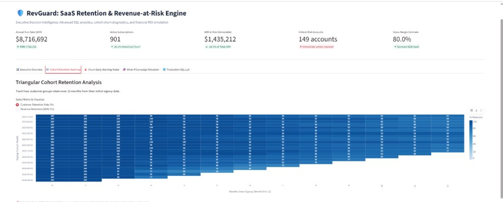
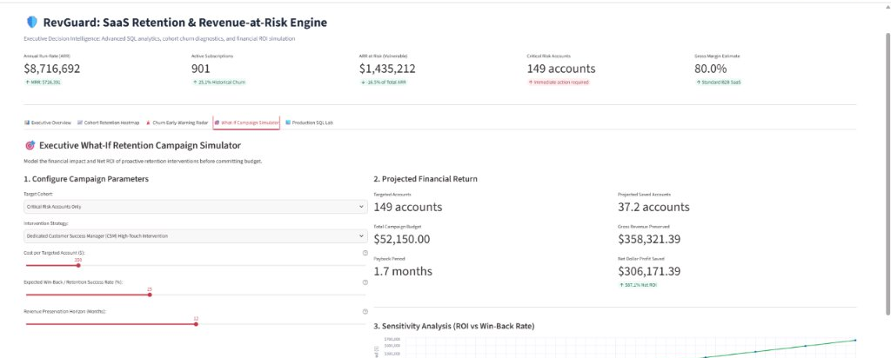

# 🛡️ RevGuard: SaaS Customer Retention & Revenue-at-Risk Simulator

[](https://revguard-saas-analytics.streamlit.app)
[]()
[](https://www.python.org/)
[]()
[]()
[]()
[]()

> **An end-to-end B2B SaaS analytics intelligence system bridging production SQL telemetry with executive financial decision-making.** Identifies customer churn risk using leading behavioral indicators and simulates the Net ROI of targeted retention campaigns in real time.

🔗 **Live Interactive Dashboard:** [https://revguard-saas-analytics.streamlit.app](https://revguard-saas-analytics.streamlit.app)

`#data-analytics` `#sql` `#business-intelligence` `#saas-metrics` `#customer-retention` `#cohort-analysis` `#financial-modeling` `#streamlit` `#python`

---

## 🖥️ Live Dashboard Preview

<div align="center">
  
  <p><em>RevGuard Executive Command Center: Real-time ARR tracking, churn risk radar, and interactive retention modeling.</em></p>
</div>

---

## 📌 Executive Summary & Business Problem

In high-growth B2B SaaS companies, **customer churn is the silent killer of Annual Recurring Revenue (ARR)**. Most analytics teams report churn *after* the customer cancels—when it is already too late.

* **Target Organization:** A B2B SaaS enterprise generating **$8.72M in ARR** across 900+ active enterprise, professional, and starter accounts.
* **The Vulnerability:** 149 accounts exhibited severe usage degradation, representing **$1,435,212 in ARR at risk (16.5% exposure)**.
* **The Solution:** Built **RevGuard**, an early-warning churn detection engine and interactive financial simulator that models proactive customer success interventions to project Net ROI and payback periods before committing marketing spend.

---

## 🏗️ System Architecture

```
┌─────────────────────────────────┐
│     Raw Relational Data         │
│ (Accounts, Usage Logs, Tickets) │
└────────────────┬────────────────┘
                 │
                 ▼
┌─────────────────────────────────┐
│    SQLite Analytics Database    │
│  (Indexed for High Performance) │
└────────────────┬────────────────┘
                 │
                 ▼
┌─────────────────────────────────┐
│     Production SQL Engine       │
│  • Multi-Level CTEs             │
│  • Window Functions (LAG, OVER) │
│  • Triangular Retention Cohorts │
└────────────────┬────────────────┘
                 │
                 ▼
┌─────────────────────────────────┐
│   Python Analytical Engine      │
│  • Leading Churn Indicators     │
│  • Financial Simulation Engine  │
└────────────────┬────────────────┘
                 │
                 ▼
┌─────────────────────────────────┐
│   Interactive Executive UI      │
│  • Real-time Churn Radar        │
│  • "What-If" ROI Simulator      │
│  • Live SQL Execution Lab       │
└─────────────────────────────────┘
```

---

## 🎯 Key Business Questions Answered

1. **Revenue Run-Rate & Trajectory:** What is our current MRR, ARR, and month-over-month growth rate?
2. **Cohort Health:** At which specific month of customer tenure do we experience the steepest drop-off?
3. **Leading Churn Indicators:** Can we detect churn 60 days *before* cancellation through login velocity and support ticket escalation?
4. **Financial Simulation:** If leadership invests \$50,000 in dedicated CSM outreach, how many accounts must be saved to break even, and what is the expected Net Profit?

---

## 📊 Core Features & Capabilities

### 1. 📈 Triangular Cohort Retention Matrix
* Visualizes month-over-month customer retention and Net Dollar Retention (NDR) from Month 0 to Month 12.
* Pinpoints Month 2–3 as the primary friction window (promotional expiry).

<div align="center">
  
</div>

### 2. 🚨 Churn Early-Warning Radar
* Filters accounts by **Composite Risk Score**:
  * **Critical Risk:** Health score < 40, login drop > 50%, or negative CSAT.
  * **High Risk:** Health score 40–60 with declining seat utilization.
* Generates an actionable CSV export for the Customer Success Management (CSM) team.

<div align="center">
  
</div>

### 3. 🎯 What-If Retention Campaign Simulator
* Allows executives to adjust:
  * **Target Cohort:** Critical vs. High-Risk accounts.
  * **Intervention Strategy:** CSM outreach, pricing discount, or executive business review.
  * **Cost per Account:** \$50 to \$2,000.
  * **Expected Win-Back Rate:** 5% to 60%.
* Outputs: **Total Budget**, **Gross ARR Preserved**, **Net Saved Revenue**, **ROI %**, and **Payback Period in Months**.

<div align="center">
  
</div>

### 4. 💻 Production SQL Lab
* Allows technical recruiters and hiring managers to inspect and execute the production SQL queries directly within the application.

<div align="center">
  
</div>

---

## 🗄️ SQL Techniques Demonstrated

All queries are located in the [`sql/`](sql/) directory:
* [`01_mrr_arr_metrics.sql`](sql/01_mrr_arr_metrics.sql): Common Table Expressions (CTEs), `LAG()` window function, MoM growth calculations.
* [`02_cohort_retention.sql`](sql/02_cohort_retention.sql): Triangular retention grid, cross-cohort month indexing, Net Revenue Retention (NDR).
* [`03_churn_risk_detection.sql`](sql/03_churn_risk_detection.sql): Rolling averages, login drop percentage, composite health classification.
* [`04_customer_lifetime_value.sql`](sql/04_customer_lifetime_value.sql): Grouped aggregations, realized vs theoretical CLV modeling.

---

## 🚀 Quickstart: Running Locally

### 1. Clone the repository
```bash
git clone https://github.com/SangitaZare/revguard-saas-analytics.git
cd revguard-saas-analytics
```

### 2. Install dependencies
```bash
pip install -r requirements.txt
```

### 3. (Optional) Re-generate data & build SQLite database
```bash
python src/data_generator.py
```

### 4. Launch the Interactive Dashboard
```bash
streamlit run app.py
```
Open [http://localhost:8501](http://localhost:8501) in your browser.

---

## 📐 Financial Modeling & Analytical Assumptions

To ensure institutional financial rigor, the simulation engine (`src/simulation_engine.py`) models unit economics under the following rules:

1. **Synthetic Telemetry Baseline:**
   * Enterprise data is realistically simulated via `src/data_generator.py` modeling 1,200 accounts over 24 historical months.
   * Churn physics exhibit empirical SaaS dynamics: active decay accounts show 50–80% login drop-offs and support CSAT degradation 45–90 days prior to renewal.

2. **Core Financial Equations:**
   $$\text{Total Campaign Cost} = N_{\text{targeted}} \times \text{Cost per Account}$$
   $$\text{Expected Saved Accounts} = N_{\text{targeted}} \times \left( \frac{\text{Win-Back Rate \%}}{100} \right)$$
   $$\text{Gross Revenue Preserved} = \text{Saved Accounts} \times \text{Avg MRR} \times \text{Horizon (Months)}$$
   $$\text{Net Profit Saved} = \text{Gross Revenue Preserved} - \text{Total Campaign Cost}$$
   $$\text{Net ROI \%} = \left( \frac{\text{Net Profit Saved}}{\text{Total Campaign Cost}} \right) \times 100$$
   $$\text{Payback Period (Months)} = \frac{\text{Total Campaign Cost}}{\text{Monthly Revenue Saved}}$$
   $$\text{Break-Even Win-Back Rate \%} = \left( \frac{\text{Total Campaign Cost}}{N_{\text{targeted}} \times \text{Avg MRR} \times \text{Horizon}} \right) \times 100$$

3. **Edge Case Guarantees:**
   * If expected win-back is 0%, Net Saved Revenue evaluates strictly to $-\text{Campaign Cost}$ (-100% ROI), and Payback Period safely maps to `None` without division-by-zero errors.

---

## 🧪 Automated Testing & Data Quality

The project includes an automated test suite (`tests/test_analytics.py`) validating relational integrity, SQL outputs, and edge-case simulation math:

```bash
# Run the automated test suite
python -m unittest discover tests -v
```

* **Database Integrity:** Validates foreign key alignments, indexing, and non-empty relational tables.
* **SQL Correctness:** Confirms non-null MRR growth series, triangular cohort constraints (Month 0 is strictly 100%), and CLV tier ordering.
* **Math & Edge Cases:** Tests negative ROI handling, 0% win-back rates, and empty target cohorts.

---

## 🔮 Limitations & Production Roadmap

While SQLite and synthetic data provide a self-contained demonstration, scaling this system to an enterprise deployment involves:

1. **Cloud Data Warehouse Migration:** Migrate the relational layer to **Snowflake / Google BigQuery**, utilizing **dbt (data build tool)** for automated daily incremental models and DAG lineage.
2. **Predictive Machine Learning:** Augment the current rule-based heuristic scoring with an **XGBoost / LightGBM churn classification pipeline** to output probabilistic churn risk with **SHAP values** for feature interpretability.
3. **Event-Driven Telemetry Ingestion:** Transition from monthly batch aggregation to real-time streaming ingestion via **Kafka or Segment webhooks**.

---

## 👤 Author

**Sangita Zare**
* GitHub: [@SangitaZare](https://github.com/SangitaZare)
* Focus: Data Analytics, Advanced SQL, Python, Business Intelligence & SaaS Economics
