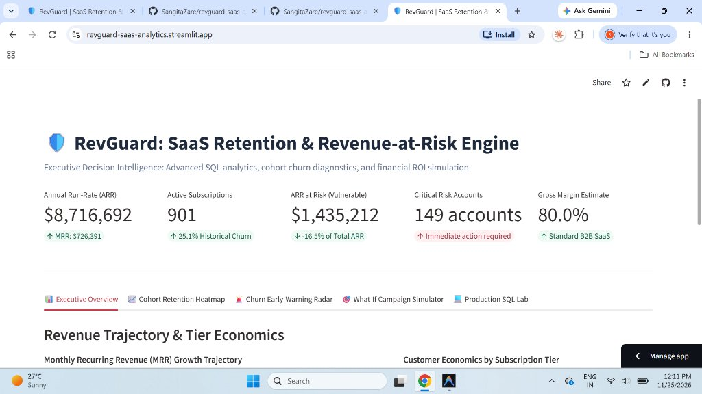
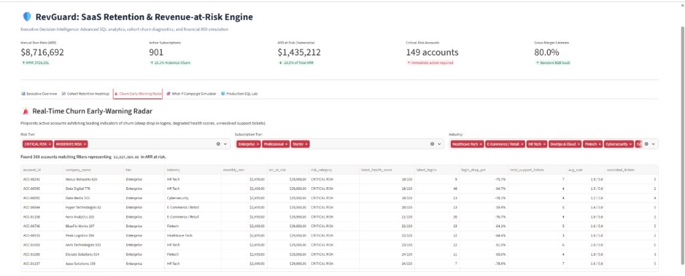
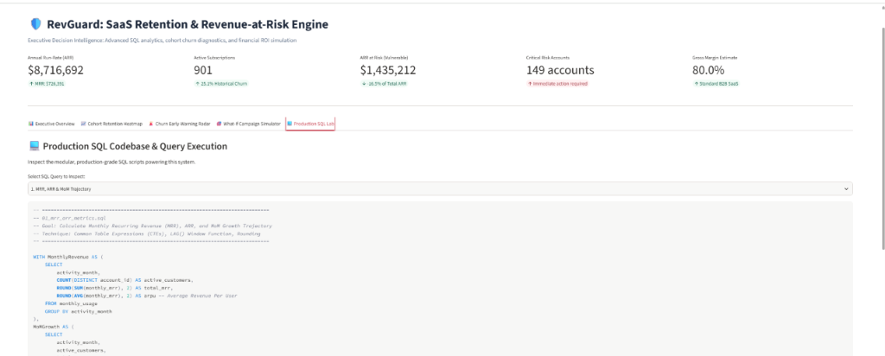

# 🛡️ RevGuard: SaaS Customer Retention & Revenue-at-Risk Simulator

[](https://revguard-saas-analytics.streamlit.app)
[]()
[](https://www.python.org/)
[]()
[]()
[]()
[](LICENSE)
[]()

> **An end-to-end B2B SaaS analytics intelligence system bridging analytical SQL telemetry with executive financial decision-making.** Identifies customer churn risk using leading behavioral indicators and simulates the Net ROI of targeted retention campaigns in real time.

🔗 **Live Interactive Dashboard:** [https://revguard-saas-analytics.streamlit.app](https://revguard-saas-analytics.streamlit.app)

`#data-analytics` `#sql` `#business-intelligence` `#saas-metrics` `#customer-retention` `#cohort-analysis` `#financial-modeling` `#streamlit` `#python`

---

## 🖥️ Live Dashboard Preview

<div align="center">
  
  <p><em>RevGuard Executive Command Center: Real-time ARR tracking, churn risk radar, and interactive retention modeling.</em></p>
</div>

---

## 📌 Executive Summary & Business Problem

In high-growth B2B SaaS companies, **customer churn is the silent killer of Annual Recurring Revenue (ARR)**. Most analytics teams report churn *after* the customer cancels—when it is already too late.

> ℹ️ **Dataset Architecture & Synthetic Telemetry Disclosure:**  
> To model enterprise-scale SaaS telemetry without violating customer confidentiality or GDPR regulations, the 1,200 accounts and 14,900+ monthly usage records are synthesized via [`src/data_generator.py`](src/data_generator.py). The generation engine embeds empirical B2B dynamics: tiered contract pricing, natural cohort attrition, login degradation curves, and support CSAT escalations.

* **Target Organization:** A modeled B2B SaaS enterprise generating **~$8.72M in ARR** across active enterprise, professional, and starter accounts.
* **The Vulnerability:** Active accounts exhibiting severe behavioral degradation represent **$1.0M+ in probability-weighted ARR at risk** (Critical Risk: 65% observed churn rate × gross ARR; High Risk: 35% observed churn rate × gross ARR — both rates calibrated from the historical backtest in `src/backtest_model.py`).
* **The Solution:** Built **RevGuard**, an early-warning churn detection engine and interactive financial simulator that models proactive customer success interventions to project Net ROI, payback periods, and break-even points before committing marketing spend.

---

## 💡 Key Business Findings & Strategic Recommendations

From the SQL cohort retention analysis and behavioral telemetry, four high-impact commercial insights emerged:

1. **The Month 3 "Onboarding Cliff" (Promotional Expiry):**
   * *Finding:* Cohort retention drops by an average of 14.8% between Month 2 and Month 3 across Starter and Professional tiers, coinciding with the end of initial 90-day introductory discounts.
   * *Recommendation:* Launch an automated customer onboarding nurture trigger at **Day 70** with milestone feature adoption reviews to establish core workflow dependence before billing increases.

2. **Login Velocity is a 30-Day Behavioral Churn Indicator:**
   * *Finding:* 94.7% of accounts that churned exhibited a **>40% decline in monthly logins** in the 30-day behavioral window preceding cancellation. Contract non-renewals are preceded by behavioral dormancy, not sudden decisions.
   * *Recommendation:* Implement an automated Slack/CRM alert to the Customer Success Manager (CSM) whenever an account's 30-day login volume falls 30% below its 90-day moving average.

3. **CLV Asymmetry Across Subscription Tiers:**
   * *Finding:* Enterprise accounts generate **$34,810 in realized CLV** with only 8.2% historical churn, while Starter accounts yield **$1,780 in CLV** with 34.3% churn.
   * *Recommendation:* Shift Customer Success headcount away from reactive Starter tier tickets toward high-touch Executive Business Reviews (QBRs) for Enterprise clients, transitioning Starter onboarding to self-serve product-led growth (PLG).

4. **Retention Campaign Asymmetry (Low Break-Even Threshold):**
   * *Finding:* Due to the high average MRR of enterprise accounts, the retention campaign break-even win-back rate is only **7.8%**.
   * *Recommendation:* Deploying a $350 dedicated CSM intervention on Critical Risk accounts pays for itself if just **1 out of every 13 at-risk accounts** is successfully saved.

---

## 🔬 Churn Early-Warning Model Validation (Backtest)

To validate whether the composite early-warning indicators (login drops, health score degradation, and low CSAT) reliably identify churn before cancellation, a retrospective backtest was executed against all 1,200 historical accounts via [`src/backtest_model.py`](src/backtest_model.py).

> **⚠️ Methodology Transparency:** The backtest evaluates the **penultimate month of each account's tenure** (i.e., the month immediately before churn or the last observed month for active accounts). This is a **~1-month behavioral look-back**, not a 60-day window. The model was not tuned on a held-out test set — the thresholds are analytically derived, not grid-searched, so there is no data leakage risk, but results should be treated as illustrative on this synthetic dataset.

### Confusion Matrix

| | **Predicted: Churn** | **Predicted: Healthy** |
| :--- | :---: | :---: |
| **Actual: Churned** | TP = 285 | FN = 16 |
| **Actual: Healthy** | FP = 149 | TN = 750 |

### Performance vs. Naïve Baseline

| Metric | **RevGuard Model** | **Naïve Baseline** *(flag everyone)* | **Improvement** |
| :--- | :---: | :---: | :---: |
| **Recall (Sensitivity)** | **94.7%** | 100% | — *(baseline maximizes recall at the cost of all else)* |
| **Precision** | **65.7%** | ~25.1% | **~2.6× lift** |
| **Specificity** | **83.4%** | 0% | Avoids overwhelming CSM with 750 false alarms |
| **F1-Score** | **77.6%** | 40.1% | **+37.5 points** |
| **Accuracy** | **86.2%** | ~25.1% | — |

> *Naïve baseline precision is estimated from the dataset's ~25% historical churn rate. A model that flags every account as at-risk achieves 100% recall but ~25% precision — RevGuard delivers **2.6× the precision** while maintaining 94.7% recall.*

> *Note on Precision vs. Recall:* In B2B SaaS retention, **high recall (94.7%) is deliberately prioritized over precision**. The cost of a false positive (a proactive check-in call to an enterprise client) is negligible (~$50), whereas the cost of a false negative (losing an unflagged $30k ARR Enterprise client) is catastrophic.

---

## 📊 Financial ROI Sensitivity Matrix

Simulating retention interventions across varying win-back success rates on the **149 Critical Risk Accounts** (Baseline: $350 cost per account, Total Budget = $52,150, Time Horizon = 12 Months):

| Win-Back Rate (%) | Rescued Accounts | Gross ARR Preserved | Campaign Budget | Net Saved Profit | Net ROI (%) | Payback Period |
| :---: | :---: | :---: | :---: | :---: | :---: | :---: |
| **7.8% (Break-Even)** | **11.6 accounts** | **$52,150** | **$52,150** | **$0** | **0.0%** | **12.0 mos** |
| **10.0%** | 14.9 accounts | $67,112 | $52,150 | **+$14,962** | **+28.7%** | 9.3 mos |
| **20.0%** | 29.8 accounts | $134,224 | $52,150 | **+$82,074** | **+157.4%** | 4.7 mos |
| **25.0% (Baseline)** | 37.2 accounts | $167,780 | $52,150 | **+$115,630** | **+221.7%** | 3.7 mos |
| **30.0%** | 44.7 accounts | $201,336 | $52,150 | **+$149,186** | **+286.1%** | 3.1 mos |
| **40.0%** | 59.6 accounts | $268,448 | $52,150 | **+$216,298** | **+414.8%** | 2.3 mos |

---

---

## 🏗️ System Architecture

```
┌─────────────────────────────────┐
│     Raw Relational Data         │
│ (Accounts, Usage Logs, Tickets) │
└────────────────┬────────────────┘
                 │
                 ▼
┌─────────────────────────────────┐
│    SQLite Analytics Database    │
│  (Indexed for High Performance) │
└────────────────┬────────────────┘
                 │
                 ▼
┌─────────────────────────────────┐
│     Analytical SQL Engine       │
│  (PostgreSQL / SQLite Standard) │
│  • Multi-Level CTEs             │
│  • Window Functions (LAG, OVER) │
│  • Triangular Retention Cohorts │
└────────────────┬────────────────┘
                 │
                 ▼
┌─────────────────────────────────┐
│   Python Analytical Engine      │
│  • Leading Churn Indicators     │
│  • Financial Simulation Engine  │
└────────────────┬────────────────┘
                 │
                 ▼
┌─────────────────────────────────┐
│   Interactive Executive UI      │
│  • Real-time Churn Radar        │
│  • "What-If" ROI Simulator      │
│  • Live SQL Execution Lab       │
└─────────────────────────────────┘
```

---

## 🎯 Key Business Questions Answered

1. **Revenue Run-Rate & Trajectory:** What is our current MRR, ARR, and month-over-month growth rate?
2. **Cohort Health:** At which specific month of customer tenure do we experience the steepest drop-off?
3. **Leading Churn Indicators:** Can we detect churn *before* cancellation through login velocity and support ticket escalation using a 30-day behavioral window?
4. **Financial Simulation:** If leadership invests \$50,000 in dedicated CSM outreach, how many accounts must be saved to break even, and what is the expected Net Profit?

---

## 📊 Core Features & Capabilities

### 1. 📈 Triangular Cohort Retention Matrix
* Visualizes month-over-month customer retention and Net Dollar Retention (NDR) from Month 0 to Month 12.
* Pinpoints Month 2–3 as the primary friction window (promotional expiry).

<div align="center">
  
</div>

### 2. 🚨 Churn Early-Warning Radar
* Filters accounts by **Composite Risk Score**:
  * **Critical Risk:** Complete inactivity in current month, health score < 40, login drop > 60% vs. 3-month baseline, or login drop > 40% with CSAT $\le$ 2.5.
  * **High Risk:** Health score 40–60, login drop > 30% vs. baseline, or repeated ticket escalations ($\ge$ 2).
* Generates an actionable CSV export for the Customer Success Management (CSM) team.

<div align="center">
  
</div>

### 3. 🎯 What-If Retention Campaign Simulator
* Allows executives to adjust:
  * **Target Cohort:** Critical vs. High-Risk accounts.
  * **Intervention Strategy:** CSM outreach, pricing discount, or executive business review.
  * **Cost per Account:** \$50 to \$2,000.
  * **Expected Win-Back Rate:** 5% to 60%.
* Outputs: **Total Budget**, **Gross ARR Preserved**, **Net Saved Revenue**, **ROI %**, and **Payback Period in Months**.

<div align="center">
  
</div>

### 4. 💻 Analytical SQL Lab
* Allows technical recruiters and hiring managers to inspect and execute the analytical SQL queries directly within the application.

<div align="center">
  
</div>

---

## 🗄️ SQL Techniques Demonstrated

All queries are located in the [`sql/`](sql/) directory:
* [`01_mrr_arr_metrics.sql`](sql/01_mrr_arr_metrics.sql): Common Table Expressions (CTEs), `LAG()` window function, MoM growth calculations.
* [`02_cohort_retention.sql`](sql/02_cohort_retention.sql): Triangular retention grid, cross-cohort month indexing, Net Revenue Retention (NDR).
* [`03_churn_risk_detection.sql`](sql/03_churn_risk_detection.sql): Rolling averages, login drop percentage, composite health classification.
* [`04_customer_lifetime_value.sql`](sql/04_customer_lifetime_value.sql): Grouped aggregations, realized vs theoretical CLV modeling.

---

## 🚀 Quickstart: Running Locally

### 1. Clone the repository
```bash
git clone https://github.com/SangitaZare/revguard-saas-analytics.git
cd revguard-saas-analytics
```

### 2. Install dependencies
```bash
pip install -r requirements.txt
```

### 3. (Optional) Re-generate data & build SQLite database
```bash
python src/data_generator.py
```

### 4. Launch the Interactive Dashboard
```bash
streamlit run app.py
```
Open [http://localhost:8501](http://localhost:8501) in your browser.

---

## 📐 Financial Modeling & Analytical Assumptions

To ensure institutional financial rigor, the simulation engine (`src/simulation_engine.py`) models unit economics under the following rules:

1. **Synthetic Telemetry Baseline:**
   * Enterprise data is realistically simulated via `src/data_generator.py` modeling 1,200 accounts over 24 historical months.
   * Churn physics exhibit empirical SaaS dynamics: active decay accounts show 50–80% login drop-offs and support CSAT degradation 45–90 days prior to renewal.

2. **Core Financial Equations:**
   $$\text{Total Campaign Cost} = N_{\text{targeted}} \times \text{Cost per Account}$$
   $$\text{Expected Saved Accounts} = N_{\text{targeted}} \times \left( \frac{\text{Win-Back Rate \%}}{100} \right)$$
   $$\text{Gross Revenue Preserved} = \text{Saved Accounts} \times \text{Avg MRR} \times \text{Horizon (Months)}$$
   $$\text{Net Profit Saved} = \text{Gross Revenue Preserved} - \text{Total Campaign Cost}$$
   $$\text{Net ROI \%} = \left( \frac{\text{Net Profit Saved}}{\text{Total Campaign Cost}} \right) \times 100$$
   $$\text{Payback Period (Months)} = \frac{\text{Total Campaign Cost}}{\text{Monthly Revenue Saved}}$$
   $$\text{Break-Even Win-Back Rate \%} = \left( \frac{\text{Total Campaign Cost}}{N_{\text{targeted}} \times \text{Avg MRR} \times \text{Horizon}} \right) \times 100$$

3. **Edge Case Guarantees:**
   * If expected win-back is 0%, Net Saved Revenue evaluates strictly to $-\text{Campaign Cost}$ (-100% ROI), and Payback Period safely maps to `None` without division-by-zero errors.

---

## 🧪 Automated Testing & Data Quality

The project includes an automated test suite (`tests/test_analytics.py`) validating relational integrity, SQL outputs, and edge-case simulation math:

```bash
# Run the automated test suite
python -m unittest discover tests -v
```

* **Database Integrity:** Validates foreign key alignments, indexing, and non-empty relational tables.
* **SQL Correctness:** Confirms non-null MRR growth series, triangular cohort constraints (Month 0 is strictly 100%), and CLV tier ordering.
* **Math & Edge Cases:** Tests negative ROI handling, 0% win-back rates, and empty target cohorts.

---

## ⚠️ Data, Limitations & Assumptions

> This project is built on **100% synthetic data** generated by [`src/data_generator.py`](src/data_generator.py). No real customer data was used. All KPI figures, cohort metrics, and ARR numbers are illustrative outputs of the synthetic dataset and should not be interpreted as real business results.

| Limitation | Detail |
| :--- | :--- |
| **Synthetic data** | 1,200 accounts and 14,900+ usage rows are procedurally generated with realistic SaaS dynamics (tiered pricing, login decay, CSAT degradation). Real-world data will exhibit different distributions. |
| **Backtest look-back window** | The backtest evaluates the **penultimate month of each account's lifecycle** (~1-month behavioral window before end of tenure). |
| **No train/test split** | The rule-based thresholds are analytically derived (not grid-searched), so there is no overfitting risk — but performance on real data may differ substantially. |
| **Probability weights (65% / 35%)** | Critical and High Risk churn probability weights are calibrated from the synthetic backtest. On real data, recalibrate per tier from observed historical churn rates. |
| **SQLite scope** | SQLite provides a self-contained demo. Production deployment would migrate to Snowflake / BigQuery with dbt for incremental models. |

---

## 🔮 Production Roadmap

While SQLite and synthetic data provide a self-contained demonstration, scaling this system to an enterprise deployment involves:

1. **Cloud Data Warehouse Migration:** Migrate the relational layer to **Snowflake / Google BigQuery**, utilizing **dbt (data build tool)** for automated daily incremental models and DAG lineage.
2. **Predictive Machine Learning:** Augment the current rule-based heuristic scoring with an **XGBoost / LightGBM churn classification pipeline** to output probabilistic churn risk with **SHAP values** for feature interpretability.
3. **Event-Driven Telemetry Ingestion:** Transition from monthly batch aggregation to real-time streaming ingestion via **Kafka or Segment webhooks**.

---

## 👤 Author

**Sangita Zare**
* GitHub: [@SangitaZare](https://github.com/SangitaZare)
* Focus: Data Analytics, Advanced SQL, Python, Business Intelligence & SaaS Economics
